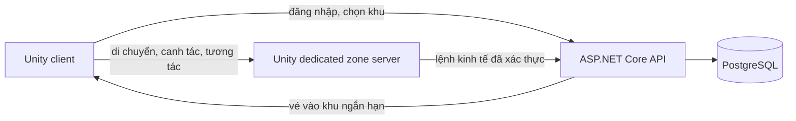

# Kiến trúc một thế giới chung, nhiều khu và kênh

**Bản đề xuất 0.1 — 21/10/2026.** Phù hợp mục tiêu: mọi tài khoản cùng một thế giới kinh tế, nhưng người chơi được chia vào các bản sao của khu đông người như kiểu kênh/khu đứng. Đây là thiết kế và lộ trình, chưa phải tính năng đang chạy.

## 1. Quyết định kiến trúc

“Một server quản lý tất cả player” nên hiểu là **một thế giới logic và một nguồn dữ liệu đúng duy nhất**. Khi đông người, thế giới đó có thể chạy trên nhiều tiến trình/máy mà người chơi vẫn dùng chung tài khoản, tiền, đất, chợ và bảng xếp hạng. Không đặt mục tiêu một tiến trình Unity giữ hàng nghìn người trong cùng một scene.

Chọn hai lớp trách nhiệm:



- **ASP.NET Core + PostgreSQL:** tài khoản, nhân vật, tiền, tồn kho, quyền đất, thuê đất, đơn hàng, đấu giá, danh bạ khu. Backend là nơi chốt giao dịch kinh tế.
- **Unity dedicated zone server:** di chuyển, vị trí, tương tác cây/NPC/máy, người nào nhìn thấy ai, phát sự kiện gameplay. Server kiểm tra hành động; client chỉ gửi ý định.
- **Unity client:** hình ảnh, input, dự đoán chuyển động nếu cần. Client không tự sửa ví, tự nhận đất hay tuyên bố đã thu hoạch thành công.

Project đã có `com.unity.netcode.gameobjects` 2.7.0, `NetworkObject` trên prefab Player, ASP.NET Core `.csproj` với EF Core và PostgreSQL. Đây là nền tảng tốt để bắt đầu. Tuy nhiên khảo sát hiện tại chưa thấy mã nguồn dịch vụ Backend, `NetworkManager` được cấu hình trong scene, hoặc `NetworkBehaviour`/RPC thực hiện đồng bộ gameplay. Tên `NetworkPlayerController` hiện không chứng minh nhân vật đã chạy đồng bộ qua mạng.

## 2. Phân biệt bản đồ, khu và kênh

**Bản đồ (`mapId`):** loại địa điểm như thị trấn, hang mỏ, chợ, trang trại.

**Kênh (`channelId`):** bản sao song song của cùng bản đồ công cộng. Ví dụ `Town-1` và `Town-2` có cùng địa hình/NPC, nhưng người chơi ở kênh khác không nhìn thấy nhau. Kênh giải quyết mật độ người, không tạo nền kinh tế riêng.

**Phiên khu (`zoneInstanceId`):** một nhóm thực thể đang được một zone server quản lý, ví dụ `Town-2` hoặc `Mine-1-3`.

**Trang trại (`farmId`, `ownerId`):** địa điểm riêng của chủ tài khoản. Nhà chính, hang mỏ và các tầng mỏ cũng là phiên riêng theo `ownerId`; người khác không được vào hoặc nhận dữ liệu của phiên này. Trạng thái ruộng, máy, vật phẩm và NPC luôn truy xuất theo tài khoản chủ.

Đề xuất ban đầu:

- `Town`: nhiều kênh công cộng, giới hạn thử nghiệm 16 người/kênh.
- `Market`: khu công cộng; bảng giao dịch vẫn chung toàn thế giới dù người chơi đứng ở kênh khác.
- `Mine`, tầng mỏ, `FarmHouse`, `FarmCave` và `Farm`: mỗi chủ tài khoản có phiên riêng; chỉ chủ được vào. Tài nguyên và phần thưởng do server kiểm tra theo `ownerId`.
- Các map còn lại như `Town` và `Market`: khu công cộng, người cùng map và kênh có thể nhìn thấy nhau.

Con số 16 là **mục tiêu tải thử ban đầu**, không phải năng lực đã đo. Chạy load test trên phần cứng triển khai thật rồi mới nâng giới hạn.

Trên giao diện, người chơi thấy danh sách kiểu **“Thị trấn — Khu 1: 12/16; Khu 2: 15/16; Khu 3: 4/16”**. Nút “Vào cùng bạn” ưu tiên kênh còn chỗ của bạn bè; nếu đầy, báo rõ và gợi ý kênh khác. Khi mọi kênh vượt ngưỡng, server mở thêm kênh nếu còn tài nguyên, rồi đưa người mới vào đó. Kênh vắng được đóng sau khi người cuối rời và trạng thái đã lưu. Đổi kênh không phải dịch chuyển miễn phí để né giao tranh, cướp tài nguyên hoặc hủy giao dịch đang chờ; áp quy tắc chuyển chỉ ở điểm/cổng hợp lệ.

Một định danh vị trí đủ rõ:

```text
worldId = 1
mapId = "Town"
channelId = 2
zoneInstanceId = "Town-2"

worldId = 1
mapId = "Farm"
farmId = 1042
zoneInstanceId = "Farm-1042"
```

Tiền, vật phẩm, bảng xếp hạng, đấu giá và tên người chơi mang khóa `worldId`/`playerId`, **không** mang `channelId` làm biên kinh tế. Chuyển từ `Town-1` sang `Town-2` không đổi tiền hoặc giá bán. Nếu chợ chia theo kênh, người chơi sẽ nhảy kênh để săn giá và tạo lỗ hổng kinh tế.

## 3. Người chơi đi từ khu này sang khu khác

Trong MVP **một tiến trình Unity dedicated server** có thể quản lý vài kênh nhỏ. Dùng `zoneInstanceId` để lọc đồng bộ: server chỉ gửi nhân vật, cây, vật phẩm rơi và NPC đang cần thiết cho client ở cùng khu. Cần kiểm tra kỹ cơ chế scene/visibility của Netcode 2.7 trước khi chọn cách triển khai cụ thể.

Trình tự chuyển khu trong cùng tiến trình:

1. Client yêu cầu đến cổng `Town-1 → Mine-1`.
2. Server kiểm tra người chơi thật sự gần cổng, khu còn chỗ, điều kiện vào khu và trạng thái đang giao dịch.
3. Server lưu trạng thái có giá trị lâu dài, chuyển định danh khu và vị trí spawn hợp lệ.
4. Client bỏ các thực thể khu cũ, nhận bản đồ/snapshot khu mới, rồi mới bật điều khiển.
5. Nếu tải khu thất bại, đưa người chơi về khu cũ hoặc điểm an toàn; không nhân đôi avatar, vật phẩm hay lệnh giao dịch.

Khi một tiến trình không đủ tải, dùng **một Unity dedicated server cho mỗi nhóm zone/kênh**. Chuyển liên tiến trình sẽ gồm: ghi trạng thái → cấp vé chuyển khu một lần có hạn ngắn → client ngắt và kết nối endpoint mới → zone đích nhận vé và spawn. Dịch vụ danh bạ khu quyết định endpoint. Bản MVP chưa cần làm chuyển liên tiến trình trước khi đo tải.

Không tự động cho một bản đồ thành một Unity scene tải chung cho mọi client. Cần bảo đảm client của kênh 1 không nhận toàn bộ object mạng và cập nhật của kênh 2. **Kênh chỉ giảm tải nếu server lọc việc mô phỏng và phát dữ liệu**, không chỉ giấu hình bằng UI.

## 4. Quyền quyết định của server

Mọi hành động thay đổi tài sản theo chuỗi:

```text
Client gửi yêu cầu: thu hoạch ô X
→ zone server xác nhận vị trí, chủ đất/quyền được giao, cây đã chín, ô chưa thu
→ backend ghi tăng tồn kho và đánh dấu mùa vụ/phiên thu hoạch bằng một transaction
→ zone server gửi kết quả, xóa/sửa cây trong khu
```

Nếu lệnh thất bại hoặc retry, transaction có `requestId` duy nhất để chỉ chốt một lần. Trước khi có đường truyền tin cậy giữa Unity server và backend, không cho client gọi thẳng endpoint “cộng tiền/bán hàng” mà không được server kiểm tra.

Lệnh mua hạt, bán nông sản, thuê NPC, mua máy, trả thuê đất và đặt giá đấu giá đều phải:

- Gắn `playerId` từ phiên đăng nhập đã xác thực, không tin ID tự khai trong payload.
- Kiểm tra số dư/tồn kho/quyền đất trên server tại thời điểm chốt.
- Trừ và cộng các số liên quan trong cùng giao dịch cơ sở dữ liệu.
- Có `requestId` chống xử lý lặp do mất mạng và retry.
- Ghi sổ giao dịch đủ để đối soát trường hợp khiếu nại.

Lệnh chuyển kênh không được hủy khoản tiền đang khóa đấu giá hoặc hoàn tiền ký quỹ. Các khoản đó thuộc thế giới chung.

## 5. Đồng hồ game và tiền thuê khi server luôn mở

`FarmDayClock` hiện chạy mặc định **14 phút/ngày game**. Nếu cứ trừ tiền thuê mỗi 7 ngày game trên server chạy 24 giờ, một ngày người chơi offline tương đương khoảng **14,7 kỳ thuê**. Người chơi sẽ mất đất khi không chơi. Đây là thay đổi bắt buộc so với bản thiết kế phòng chơi cũ.

Đề xuất cho bản đầu:

- **Thời gian thế giới:** đồng hồ server liên tục dùng cho chợ, các kênh công cộng, lịch NPC, thông báo và lịch đấu giá. Tính theo UTC trên backend; mọi người ở cùng kênh công cộng nhận cùng thời gian gameplay.
- **Ngày hoạt động của trang trại:** chỉ tiến khi chủ thực sự ở trạng thái chơi hợp lệ. Cây, NPC thuê và phí vận hành máy cùng đi theo ngày hoạt động này. Khi chủ offline, trang trại được lưu và đóng băng.
- **Cây qua mùa:** đổi mùa theo ngày hoạt động riêng của chủ, không theo thời gian thế giới. Cây đã trồng không tự hỏng khi qua mùa và vẫn được lớn lên, thu hoạch lần đầu; chỉ giới hạn gieo hạt mới theo mùa. Cây tái thu hoạch dừng tạo lứa mới ngoài mùa phù hợp, nhưng sản phẩm đã chín vẫn có thể thu. Quy tắc được kiểm tra và lưu bởi server để đổi mùa hoặc đăng nhập lại không xóa cây.
- **Hiển thị sáng/tối cá nhân:** có thể cho mỗi máy vẽ ánh sáng khác nhau khi đến `Town`, nhưng chỉ là hiệu ứng hình ảnh. Điều kiện mở cửa, NPC, vật phẩm, phần thưởng và việc sang ngày dùng thời gian do server xác nhận. Client gửi yêu cầu hành động, không được tự khai thời gian hoặc tự tăng ngày để nhận tiền.
- **Tiền thuê:** thu sau mỗi **7 ngày hoạt động của trang trại**, không thu theo 98 phút đồng hồ tường khi chủ offline. Chỉ tăng ngày hoạt động một lần cho mỗi ngày farm hoàn thành; ngắt rồi nối lại không được tạo ngày mới miễn phí.
- **Nợ và cảnh báo cưỡng chế:** tuổi nợ cũng tính theo ngày hoạt động của chủ, vì nếu không người chơi vẫn có thể mất đất khi offline. Người cố tình tránh đăng nhập không được tiếp tục sản xuất hoặc rao đất; nợ vẫn nằm trên tài khoản và phải xử lý khi trở lại.
- **Đấu giá đất NPC:** chạy theo thời gian thế giới, cửa sổ dự thầu theo giờ thật, đủ dài để người chơi ở nhiều múi giờ có cơ hội tham gia.
- **Đấu giá đất cưỡng chế:** chỉ bắt đầu sau khi người chơi đã trải qua thời gian cảnh báo bằng ngày hoạt động. Khi hồ sơ đã mở, lịch chốt dùng giờ thật và được công bố trước.

Quy tắc này cho phép một server luôn hoạt động mà người vắng mặt không bị phá sản vì đồng hồ chạy nền. Đổi lại, bảng xếp hạng mùa phải so sánh ở **cùng số ngày hoạt động** (ví dụ sau 28 ngày hoạt động đầu tiên), không so người chơi 28 ngày với người mới được 4 ngày.

Nếu sau này muốn thế giới MMO chạy mọi cây và mọi tiền thuê khi offline, cần một chu kỳ ngày dài hơn rất nhiều, chế độ ủy quyền NPC, nguồn thu offline và cách bảo vệ người chơi vắng mặt. Đó là một thiết kế khác.

## 6. Dữ liệu tối thiểu cần lưu

MVP PostgreSQL cần các nhóm bản ghi:

- `Players`: tài khoản, nhân vật, trạng thái truy cập.
- `Wallets` và `LedgerEntries`: số dư hiện tại, mọi khoản cộng/trừ, mã giao dịch và request id.
- `InventoryStacks`: vật phẩm, số lượng, phiên bản để kiểm tra cập nhật đồng thời.
- `Farms`, `LandPlots`, `CropStates`: chủ quyền khai thác, ô đất, giống, pha tăng trưởng, ngày farm đã tưới/thu.
- `WorldZones`: thế giới, map, kênh, số người, server endpoint, trạng thái mở.
- `PlayerLocations`: khu và vị trí an toàn đã lưu.
- `FarmClocks`, `RentInvoices`: số ngày hoạt động, ngày đến hạn và nợ.
- `Auctions`, `Bids`, `Escrows`: lô đất, giá, tiền khóa, thời điểm chốt và người thắng.

Không lưu vị trí mỗi frame vào PostgreSQL. Di chuyển thường xuyên ở bộ nhớ zone server và cập nhật checkpoint khi chuyển khu/đăng xuất/theo chu kỳ. Tiền và quyền đất phải chốt ngay bằng transaction; đó là dữ liệu không được để mất.

## 7. Lộ trình triển khai phù hợp project

**Mốc A — Một khu, hai client:** tạo `NetworkManager`/Unity Transport trong scene, chạy dedicated server local, hai client vào cùng thị trấn; server spawn Player và đồng bộ vị trí. Chứng minh mỗi người chỉ điều khiển avatar của mình. Tên `NetworkPlayerController` hiện cần được chuyển thành hành vi có xác thực phía server.

**Mốc B — Backend một thế giới:** tạo API đăng nhập, nhân vật, ví, tồn kho; PostgreSQL lưu bền; mọi khoản mua/bán dùng transaction và `requestId`. Mất kết nối rồi vào lại vẫn còn tiền/tài sản đúng.

**Mốc C — Hai kênh của cùng map:** ví dụ Town-1 và Town-2, tối đa mục tiêu 16 người/kênh. Người ở khác kênh không thấy nhau nhưng cùng bảng giá và chợ. Chuyển kênh không đổi tiền/tồn kho.

**Mốc D — Trang trại và hang:** farm, nhà chính và mỏ là phiên riêng chỉ chủ tài khoản được vào; crop state được lưu. Bật ngày hoạt động và tiền thuê sau khi lưu cây ổn định; server kiểm soát thời điểm sang ngày.

**Mốc E — Đấu giá:** trước hết đấu giá lô của Hội đồng; sau đó mới đấu giá lô bị cưỡng chế. Kiểm tra đặt giá đồng thời, trả tiền khóa, hòa giá, mất mạng đúng lúc chốt, và chặn chuyển đất hai lần.

**Mốc F — Tách tiến trình:** chỉ làm khi số liệu cho thấy một tiến trình không còn đáp ứng tải. Thêm danh bạ zone, vé chuyển server và giám sát từng tiến trình.

## 8. Bài kiểm tra chấp nhận kiến trúc

1. Hai người cùng khu công cộng thấy nhau; sang kênh khác thì không nhận cập nhật vị trí của nhau. Khi cùng báo `Farm`, `FarmHouse`, `Mine` hoặc cùng tầng mỏ, mỗi người chỉ nhận phiên riêng của mình.
2. Sang kênh không đổi ví, hàng tồn, giá NPC, đất hoặc nợ.
3. Một lệnh bán hàng gửi hai lần chỉ ghi tiền một lần.
4. Hai người đồng thời mua một lô đất chỉ một người nhận quyền; người còn lại không mất tiền.
5. Người offline 24 giờ thực không tự phát sinh hơn 14 hóa đơn thuê; cây/NPC trên farm riêng không chạy không kiểm soát.
6. Hai client thu cùng một cây chỉ một người nhận sản phẩm.
7. Server zone chết rồi khởi động lại: vật phẩm, tiền và đất khôi phục từ trạng thái đã chốt; vị trí có thể về điểm an toàn.
8. Ở tải mục tiêu 16 người/kênh, đo CPU, RAM, gói tin/người và độ trễ hành động; không tuyên bố hỗ trợ hàng trăm người trước khi có số liệu.
9. Client sửa đồng hồ hoặc gửi liên tiếp yêu cầu sang ngày không làm server trả thưởng, tăng ngày trang trại hay thay đổi phiên đấu giá trước thời điểm hợp lệ.
10. Chủ trang trại offline qua thời điểm đổi mùa của thế giới vẫn thấy cây và mùa cũ khi trở lại; khi ngày hoạt động của mình sang mùa mới, cây đã trồng không bị xóa và vẫn thu hoạch được theo quy tắc cây qua mùa.

## 9. Tài liệu kỹ thuật tham khảo

- [Unity: Netcode for GameObjects](https://docs.unity3d.com/Manual/com.unity.netcode.gameobjects.html).
- [Unity: Dedicated Server build](https://docs.unity3d.com/Manual/dedicated-server-build.html).
- [Unity Multiplayer: Object visibility](https://docs-multiplayer.unity3d.com/netcode/2.0.0/basics/object-visibility/).
- [Unity Multiplayer: Client synchronization mode](https://docs-multiplayer.unity3d.com/netcode/2.2.0/basics/scenemanagement/client-synchronization-mode/).

Các tài liệu Unity mô tả khả năng của SDK. Cách chia kênh, đóng băng farm offline và thứ tự triển khai ở trên là **đề xuất kiến trúc cho project này**, không phải tính năng có sẵn khi chỉ cài Netcode.
